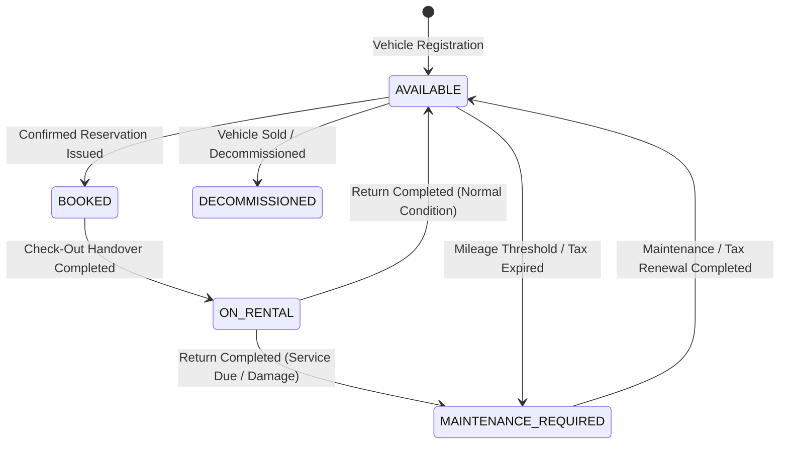
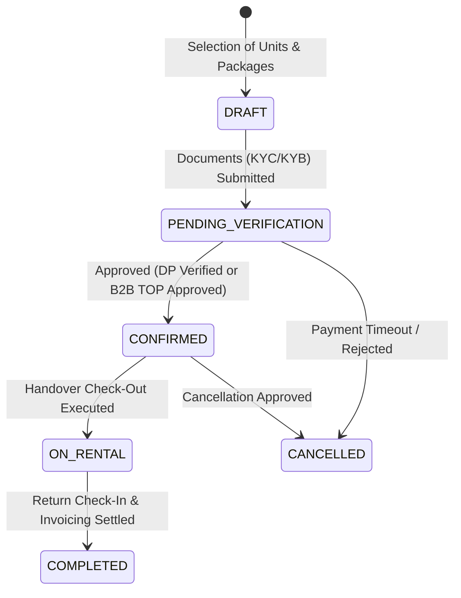

# Database Schema & Data Models — Ashvin FleetOS (AFOS)
**Integrated Car Rental Information and Sales Operating System**  
*Unified B2C & B2B PostgreSQL Database Schema (Supabase)*

---

## 1. Lifecycle State Machine Diagrams

### 1.1. Physical Vehicle Unit Lifecycle (`vehicles.status`)


### 1.2. Booking & Item Lifecycle


---

## 2. Core PostgreSQL Table Definitions (DDL)

### 2.1. User Profiles & Corporate Accounts
```sql
CREATE TYPE user_role_enum AS ENUM ('CUSTOMER', 'FIELD_STAFF', 'ADMIN', 'OWNER');
CREATE TYPE payment_terms_enum AS ENUM ('IMMEDIATE', 'TOP_14', 'TOP_30', 'TOP_60');

CREATE TABLE user_profiles (
    id UUID PRIMARY KEY REFERENCES auth.users(id) ON DELETE CASCADE,
    role user_role_enum NOT NULL DEFAULT 'CUSTOMER',
    full_name VARCHAR(150) NOT NULL,
    phone_number VARCHAR(30) NOT NULL,
    id_card_number VARCHAR(50), -- KTP for WNI / Passport for WNA
    driver_license_number VARCHAR(50), -- SIM A / IDP
    nationality VARCHAR(50) DEFAULT 'ID',
    emergency_contact_name VARCHAR(150),
    emergency_contact_phone VARCHAR(30),
    preferred_locale VARCHAR(10) DEFAULT 'id',
    created_at TIMESTAMPTZ NOT NULL DEFAULT NOW(),
    updated_at TIMESTAMPTZ NOT NULL DEFAULT NOW()
);

CREATE TABLE corporate_accounts (
    id UUID PRIMARY KEY DEFAULT gen_random_uuid(),
    company_name VARCHAR(200) NOT NULL,
    tax_id VARCHAR(50) NOT NULL, -- NPWP
    business_id VARCHAR(50) NOT NULL, -- NIB
    billing_address TEXT NOT NULL,
    pic_user_id UUID REFERENCES user_profiles(id),
    pic_name VARCHAR(150) NOT NULL,
    pic_phone VARCHAR(30) NOT NULL,
    pic_email VARCHAR(100) NOT NULL,
    credit_limit NUMERIC(14, 2) NOT NULL DEFAULT 50000000.00,
    payment_terms payment_terms_enum NOT NULL DEFAULT 'TOP_30',
    is_active BOOLEAN NOT NULL DEFAULT TRUE,
    created_at TIMESTAMPTZ NOT NULL DEFAULT NOW()
);
```

### 2.2. Vehicles, Packages, and Drivers
```sql
CREATE TYPE vehicle_status_enum AS ENUM (
    'AVAILABLE', 'BOOKED', 'ON_RENTAL', 'MAINTENANCE_REQUIRED', 'DECOMMISSIONED'
);
CREATE TYPE transmission_enum AS ENUM ('MANUAL', 'AUTOMATIC');
CREATE TYPE service_type_enum AS ENUM ('SELF_DRIVE', 'WITH_DRIVER');
CREATE TYPE service_area_enum AS ENUM ('IN_TOWN', 'OUT_OF_TOWN');
CREATE TYPE driver_status_enum AS ENUM ('AVAILABLE', 'ASSIGNED', 'OFF_DUTY');

CREATE TABLE vehicles (
    id UUID PRIMARY KEY DEFAULT gen_random_uuid(),
    license_plate VARCHAR(20) NOT NULL UNIQUE,
    brand VARCHAR(50) NOT NULL,
    model VARCHAR(50) NOT NULL,
    year SMALLINT NOT NULL,
    transmission transmission_enum NOT NULL,
    seating_capacity SMALLINT NOT NULL DEFAULT 7,
    current_odometer_km INT NOT NULL DEFAULT 0,
    last_service_odometer_km INT NOT NULL DEFAULT 0,
    last_oil_change_odometer_km INT NOT NULL DEFAULT 0,
    stnk_tax_due_date DATE NOT NULL,
    total_trip_count INT NOT NULL DEFAULT 0,
    status vehicle_status_enum NOT NULL DEFAULT 'AVAILABLE',
    is_active BOOLEAN NOT NULL DEFAULT TRUE,
    image_url TEXT,
    created_at TIMESTAMPTZ NOT NULL DEFAULT NOW(),
    updated_at TIMESTAMPTZ NOT NULL DEFAULT NOW()
);

CREATE TABLE rental_packages (
    id UUID PRIMARY KEY DEFAULT gen_random_uuid(),
    name VARCHAR(100) NOT NULL,
    service_type service_type_enum NOT NULL,
    service_area service_area_enum NOT NULL,
    duration_hours SMALLINT NOT NULL,
    base_price NUMERIC(12, 2) NOT NULL,
    deposit_amount NUMERIC(12, 2) NOT NULL DEFAULT 0,
    includes_fuel BOOLEAN NOT NULL DEFAULT FALSE,
    is_active BOOLEAN NOT NULL DEFAULT TRUE,
    created_at TIMESTAMPTZ NOT NULL DEFAULT NOW()
);

CREATE TABLE drivers (
    id UUID PRIMARY KEY DEFAULT gen_random_uuid(),
    user_id UUID REFERENCES user_profiles(id),
    full_name VARCHAR(150) NOT NULL,
    phone_number VARCHAR(30) NOT NULL,
    license_number VARCHAR(50) NOT NULL,
    status driver_status_enum NOT NULL DEFAULT 'AVAILABLE',
    is_active BOOLEAN NOT NULL DEFAULT TRUE,
    created_at TIMESTAMPTZ NOT NULL DEFAULT NOW()
);
```

### 2.3. Unified Orders: Master Bookings & Booking Items (1:N)
```sql
CREATE TYPE order_type_enum AS ENUM ('B2C_RETAIL', 'B2B_CORPORATE');
CREATE TYPE booking_status_enum AS ENUM (
    'DRAFT', 'PENDING_VERIFICATION', 'CONFIRMED', 'ON_RENTAL', 'COMPLETED', 'CANCELLED'
);

CREATE TABLE bookings (
    id UUID PRIMARY KEY DEFAULT gen_random_uuid(),
    booking_code VARCHAR(30) NOT NULL UNIQUE, -- e.g. AFOS-202611-001
    order_type order_type_enum NOT NULL DEFAULT 'B2C_RETAIL',
    customer_id UUID REFERENCES user_profiles(id), -- B2C customer or B2B PIC
    corporate_account_id UUID REFERENCES corporate_accounts(id), -- NULL for B2C
    po_number VARCHAR(100), -- Corporate Purchase Order reference
    status booking_status_enum NOT NULL DEFAULT 'DRAFT',
    total_amount NUMERIC(14, 2) NOT NULL DEFAULT 0,
    security_deposit_amount NUMERIC(12, 2) NOT NULL DEFAULT 0,
    approved_by UUID REFERENCES user_profiles(id),
    approved_at TIMESTAMPTZ,
    created_at TIMESTAMPTZ NOT NULL DEFAULT NOW(),
    updated_at TIMESTAMPTZ NOT NULL DEFAULT NOW()
);

CREATE TABLE booking_items (
    id UUID PRIMARY KEY DEFAULT gen_random_uuid(),
    booking_id UUID NOT NULL REFERENCES bookings(id) ON DELETE CASCADE,
    vehicle_id UUID NOT NULL REFERENCES vehicles(id),
    package_id UUID NOT NULL REFERENCES rental_packages(id),
    driver_id UUID REFERENCES drivers(id),
    start_time TIMESTAMPTZ NOT NULL,
    end_time TIMESTAMPTZ NOT NULL,
    unit_price NUMERIC(12, 2) NOT NULL,
    status booking_status_enum NOT NULL DEFAULT 'DRAFT',
    is_replacement BOOLEAN NOT NULL DEFAULT FALSE,
    replaced_item_id UUID REFERENCES booking_items(id),
    created_at TIMESTAMPTZ NOT NULL DEFAULT NOW()
);
```

### 2.4. Operational Handovers: Check-Out and Check-In
```sql
CREATE TABLE handovers_checkout (
    id UUID PRIMARY KEY DEFAULT gen_random_uuid(),
    booking_item_id UUID NOT NULL UNIQUE REFERENCES booking_items(id),
    vehicle_id UUID NOT NULL REFERENCES vehicles(id),
    staff_id UUID NOT NULL REFERENCES user_profiles(id),
    checkout_odometer_km INT NOT NULL,
    checkout_fuel_level SMALLINT NOT NULL CHECK (checkout_fuel_level BETWEEN 1 AND 8),
    body_inspection_json JSONB NOT NULL DEFAULT '{}',
    photos_json JSONB NOT NULL DEFAULT '[]',
    customer_signature_url TEXT NOT NULL,
    staff_signature_url TEXT NOT NULL,
    checkout_notes TEXT,
    checkout_timestamp TIMESTAMPTZ NOT NULL DEFAULT NOW()
);

CREATE TABLE returns_checkin (
    id UUID PRIMARY KEY DEFAULT gen_random_uuid(),
    booking_item_id UUID NOT NULL UNIQUE REFERENCES booking_items(id),
    vehicle_id UUID NOT NULL REFERENCES vehicles(id),
    staff_id UUID NOT NULL REFERENCES user_profiles(id),
    checkin_odometer_km INT NOT NULL,
    checkin_fuel_level SMALLINT NOT NULL CHECK (checkin_fuel_level BETWEEN 1 AND 8),
    distance_traveled_km INT GENERATED ALWAYS AS (checkin_odometer_km - checkout_odometer_km) STORED,
    overtime_hours NUMERIC(4, 1) NOT NULL DEFAULT 0,
    overtime_penalty_fee NUMERIC(12, 2) NOT NULL DEFAULT 0,
    fuel_penalty_fee NUMERIC(12, 2) NOT NULL DEFAULT 0,
    damage_penalty_fee NUMERIC(12, 2) NOT NULL DEFAULT 0,
    body_inspection_json JSONB NOT NULL DEFAULT '{}',
    photos_json JSONB NOT NULL DEFAULT '[]',
    customer_signature_url TEXT NOT NULL,
    staff_signature_url TEXT NOT NULL,
    checkin_timestamp TIMESTAMPTZ NOT NULL DEFAULT NOW()
);
```

### 2.5. Financial Invoices, Cash Ledger & Audit Trail
```sql
CREATE TYPE invoice_status_enum AS ENUM ('ISSUED', 'PARTIALLY_PAID', 'PAID', 'OVERDUE');
CREATE TYPE financial_entry_type AS ENUM (
    'INCOME_RENTAL_DP', 'INCOME_RENTAL_SETTLEMENT', 'HOLD_SECURITY_DEPOSIT',
    'RELEASE_SECURITY_DEPOSIT', 'INCOME_PENALTY_OVERTIME', 'INCOME_PENALTY_FUEL',
    'INCOME_PENALTY_DAMAGE', 'INCOME_B2B_INVOICE_SETTLEMENT', 'EXPENSE_MAINTENANCE'
);

CREATE TABLE financial_invoices (
    id UUID PRIMARY KEY DEFAULT gen_random_uuid(),
    booking_id UUID NOT NULL REFERENCES bookings(id),
    corporate_account_id UUID REFERENCES corporate_accounts(id),
    invoice_number VARCHAR(50) NOT NULL UNIQUE,
    subtotal_amount NUMERIC(14, 2) NOT NULL,
    ppn_tax_amount NUMERIC(12, 2) NOT NULL DEFAULT 0, -- 11% PPN
    pph23_tax_amount NUMERIC(12, 2) NOT NULL DEFAULT 0, -- 2% PPh 23
    total_amount NUMERIC(14, 2) NOT NULL,
    due_date DATE NOT NULL,
    status invoice_status_enum NOT NULL DEFAULT 'ISSUED',
    created_at TIMESTAMPTZ NOT NULL DEFAULT NOW()
);

CREATE TABLE financial_entries (
    id UUID PRIMARY KEY DEFAULT gen_random_uuid(),
    booking_id UUID REFERENCES bookings(id),
    invoice_id UUID REFERENCES financial_invoices(id),
    entry_type financial_entry_type NOT NULL,
    amount NUMERIC(14, 2) NOT NULL,
    recorded_by UUID NOT NULL REFERENCES user_profiles(id),
    approved_by UUID REFERENCES user_profiles(id),
    payment_method VARCHAR(50) NOT NULL DEFAULT 'BANK_TRANSFER',
    payment_proof_url TEXT,
    notes TEXT,
    created_at TIMESTAMPTZ NOT NULL DEFAULT NOW()
);

CREATE TABLE audit_logs (
    id UUID PRIMARY KEY DEFAULT gen_random_uuid(),
    entity_name VARCHAR(50) NOT NULL,
    entity_id UUID NOT NULL,
    action_type VARCHAR(50) NOT NULL,
    actor_id UUID NOT NULL REFERENCES user_profiles(id),
    actor_role user_role_enum NOT NULL,
    old_data JSONB,
    new_data JSONB,
    description TEXT NOT NULL,
    created_at TIMESTAMPTZ NOT NULL DEFAULT NOW()
);
```

---

## 3. Immutability Triggers
```sql
CREATE OR REPLACE FUNCTION prevent_modification()
RETURNS TRIGGER AS $$
BEGIN
    RAISE EXCEPTION 'Operation not permitted! Target table is strictly append-only for audit integrity.';
END;
$$ LANGUAGE plpgsql;

CREATE TRIGGER trg_immutable_audit_logs
BEFORE UPDATE OR DELETE ON audit_logs
FOR EACH ROW EXECUTE FUNCTION prevent_modification();

CREATE TRIGGER trg_immutable_financial_entries
BEFORE UPDATE OR DELETE ON financial_entries
FOR EACH ROW EXECUTE FUNCTION prevent_modification();
```
